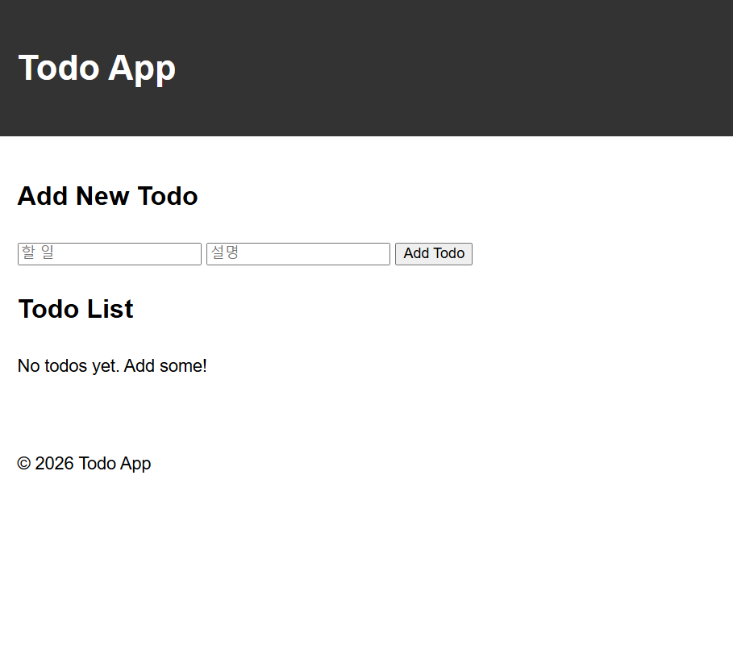
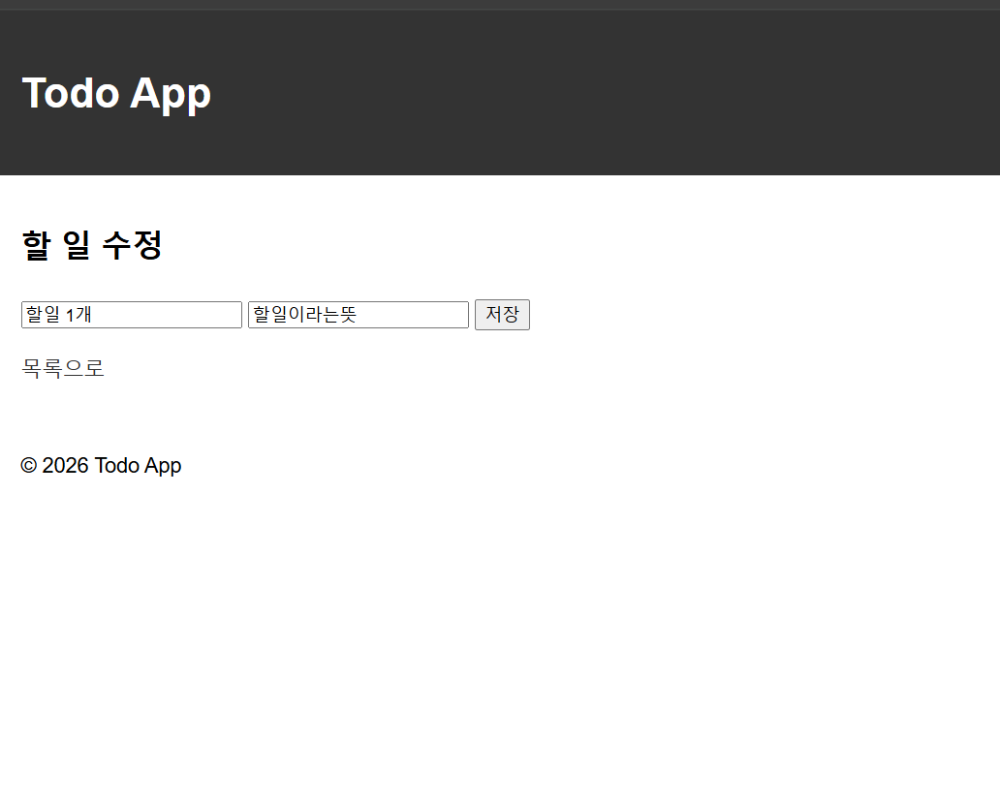
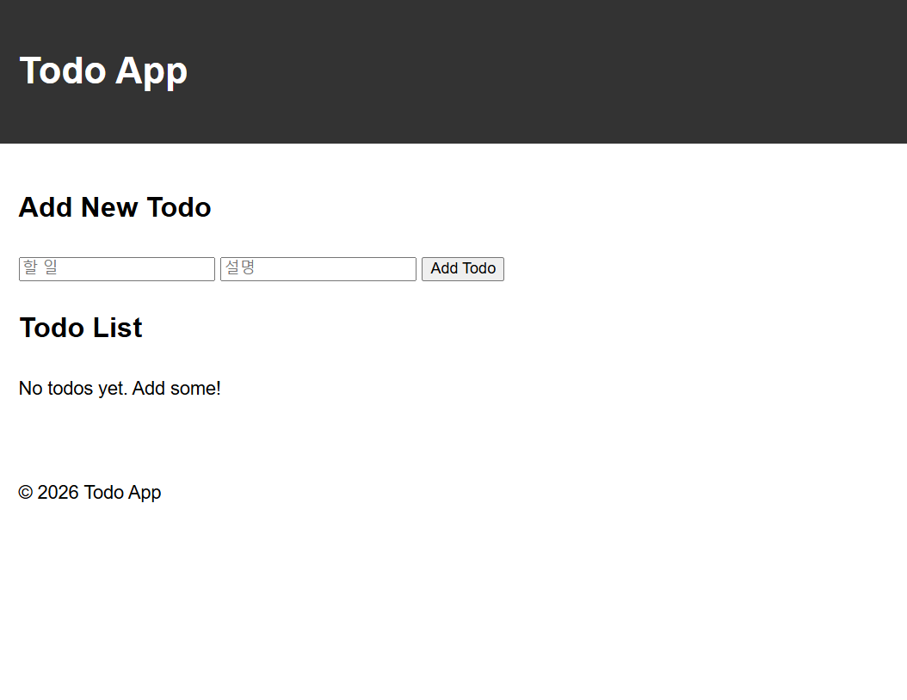

# HW3 — Todo 앱에 수정 기능 더하기

- 이름: 이승민
- 학번: 24013735

## 폴더 설명

- `app.py` — 목록/추가(`/`), 완료 토글(`/toggle/<id>`), 삭제(`/delete/<id>`), 수정(`/edit/<id>`)
- `templates/` — `base.html`(공통 틀), `index.html`(목록), `edit.html`(수정 화면)
- `static/style.css` — 화면 꾸밈
- 데이터는 SQLite(`instance/todo.db`, 저장소에 올리지 않음)에 저장됩니다.

## 실행 방법

```
cd HW3
flask --debug run
```

## 실행 화면

### 1. 목록 화면



- 할 일 입력칸과 설명 입력칸, `Add Todo` 버튼이 있고 아래에 Todo List가 나옵니다.

### 2. 수정 화면



- `[수정]`을 누르면 나오는 화면입니다. 할 일(`할일 1개`)과 설명(`할일이라는뜻`) 입력칸에 지금 값이 들어 있고, `저장` 버튼과 `목록으로` 링크가 있습니다.

### 3. 서버를 껐다 켠 뒤의 목록



- 서버를 껐다 켠 뒤 다시 연 목록 화면입니다.
