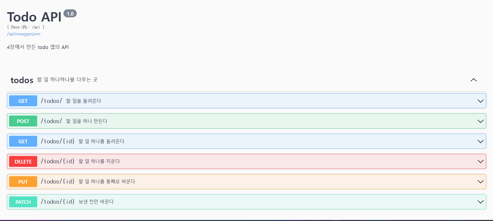
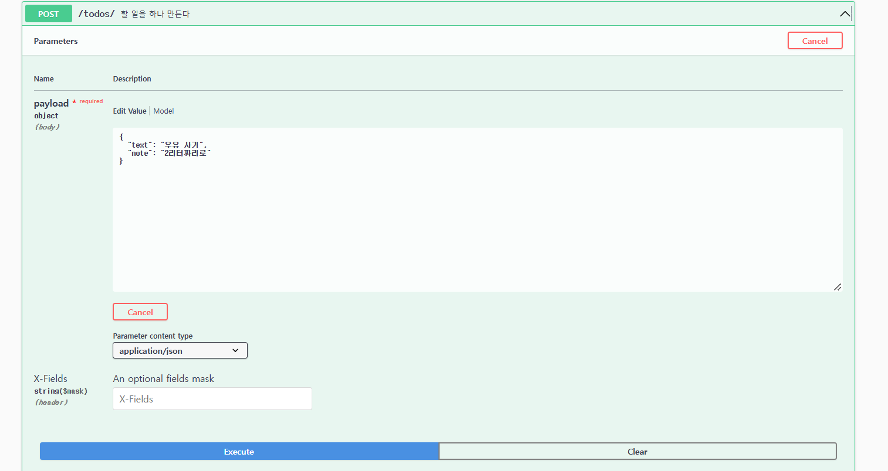
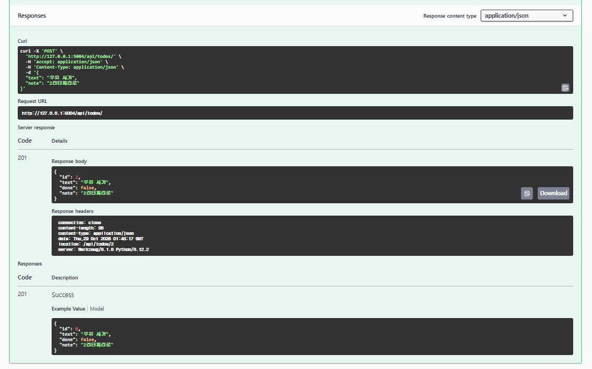
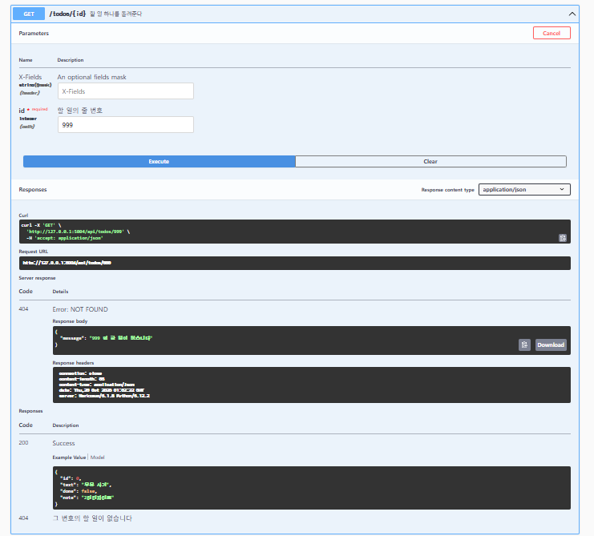

# HW4 : todo 앱에 API 더하기

- 이름: 이승민
- 학번: 24013735

## 더한 것

- 설명 칸(note)을 API 로도 주고받게 했습니다.
- GET /api/todos/?done=true 로 완료한 것만 골라 받게 했습니다.

## 실행하는 법

    pip install -r requirements.txt
    flask --debug run
    화면 http://127.0.0.1:5000/
    문서 http://127.0.0.1:5000/api/docs

테스트는 `python -m unittest` 로 실행합니다. (instance/todo.db 를 건드리지 않습니다)

## 화면

### 1. 주소 여섯 줄이 모두 보이는 문서

- `/api/docs` 에서 todos 묶음을 펼친 모습입니다. GET `/todos/`, POST `/todos/`, GET `/todos/{id}`, DELETE `/todos/{id}`, PUT `/todos/{id}`, PATCH `/todos/{id}` 여섯 줄이 보입니다.

### 2. note 를 넣어 만들었더니 201 이 온 모습

- POST `/todos/` 에 `{"text": "우유 사기", "note": "2리터짜리로"}` 를 넣은 요청 화면입니다.

- Execute 한 결과입니다. 상태 코드 201 과 함께 Response body 에 `note` 가 그대로 돌아오고, `location: /api/todos/2` 헤더가 붙습니다.

### 3. 없는 번호를 불렀더니 404 가 온 모습

- GET `/todos/{id}` 에 없는 번호 999 를 넣은 결과입니다. 상태 코드 404 와 `{"message": "..."}` 가 함께 돌아옵니다.
