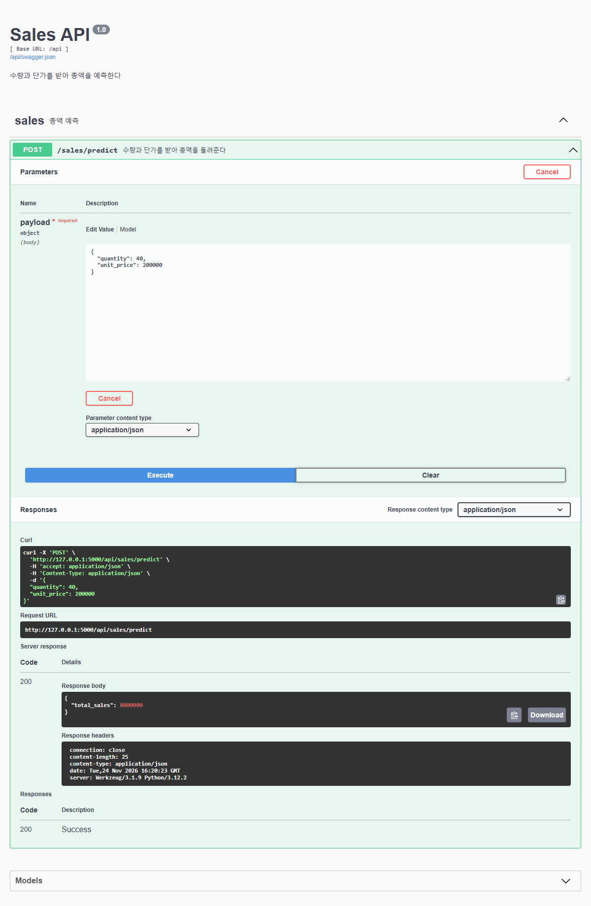

# HW6

이승민 · 24013735

## 실행방법

```bash
# 이 폴더(HW6)에서
python -m venv .venv
.venv\Scripts\activate          # 맥·리눅스: source .venv/bin/activate
pip install pandas matplotlib scikit-learn joblib flask flask-restx jupyter ipykernel
```

1. `.venv` 에서 jupyter(VS Code)로 `hw6.ipynb` 를 Restart → Run All. `sales_clean.csv` 를 읽고 `sales_model.pkl` 을 다시 만든다.
2. `flask --app app run` 뒤 http://127.0.0.1:5000/api/docs 에서 `POST /api/sales/predict` → Try it out → Execute.



수량 40 · 단가 200,000 을 보내면 Response body 가 `{"total_sales": 8000000}`.

## 단계③ 답

- linear regression 은 `a·수량 + b·단가 + c` 처럼 열마다 숫자를 곱해 더하는 것만 할 수 있는데, 총액은 수량 × 단가라는 곱셈이다. 곱셈을 평평한 면으로 흉내 내므로 수량과 단가가 둘 다 크거나 작은 주문에서 많이 틀려 test R² 가 0.862 에 그친다.
- qp = 수량 × 단가 열을 더하면 곱셈이 이미 열 안에 있어서 model 은 qp 계수 1, 나머지 0, 절편 0(coef [0, 0, 1])만 찾으면 된다. 「총액 = qp」를 그대로 찾았으므로 R² 가 1.0 이다.

## 단계⑤ 결정과 이유

- **max_depth 8.** cross-validation(cv=5) 평균이 depth 8 은 0.992, depth 12 와 제한 없음은 0.995 로 0.003 차이뿐이고 표준편차도 0.000 ~ 0.001 로 같다. score 가 거의 같으면 단순한 쪽을 고르므로 잎 250 개(depth 8)를 잎 781 개(depth 12) 대신 고른다.
- training 1.000 과 test 0.994 의 차이가 작은 것은 총액 = 수량 × 단가라는 규칙이 실제로 있는 문제라서, 잘게 외워도 test 에서 그대로 맞기 때문이다.

## 단계⑦ 답

- API 에 올린 model 은 **linear regression + qp**. 수량 40 · 단가 200,000 에 대해 linear + qp 는 8,000,000 으로 실제 곱 8,000,000 과 정확히 같고, tree (depth 8) 는 7,362,301 로 약 64만 원(8%) 틀린다.
- tree 는 training 에서 비슷했던 주문들의 평균(계단)으로 답하므로 R² 0.99 라도 한 건씩은 어긋나고 training 범위 밖 값은 낼 수 없다. linear + qp 는 공식(총액 = qp)을 찾았으므로 어떤 입력에도 곱을 정확히 돌려준다. 서버에서도 학습 때처럼 `qp` 열을 만들어 넣는다(`app.py`).
